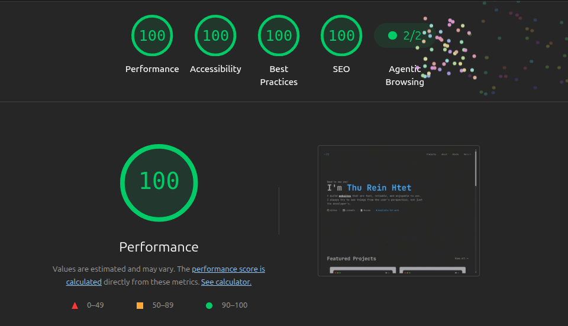

# Portfolio

Personal portfolio of **Thu Rein Htet** — a terminal-inspired website showcasing my projects, work experience, blog posts, and adventures beyond coding.

## Features

- Showcase featured projects
- Publish blog posts written in Markdown
- Display work experience
- View resume
- Contact form with email support
- Optional AI assistant that answers questions about the portfolio, with source links and a job-description fit check
- Admin dashboard for content management
- Fully responsive design

**Live Demo:** https://thureinhtet-portfolio.vercel.app

## Built With

| Category       | Technology                                      |
| -------------- | ----------------------------------------------- |
| Framework      | Next.js 16 (App Router)                         |
| Language       | TypeScript                                      |
| UI             | React 19, shadcn/ui (Radix UI)                  |
| Styling        | Tailwind CSS v4                                 |
| Database       | Drizzle ORM, SQLite (local), Turso (production) |
| Authentication | Better Auth                                     |
| Animation      | Framer Motion, React View Transitions           |
| Storage        | Cloudinary                                      |
| Email          | Nodemailer                                      |
| Automation     | Makefile                                        |

## Project Structure

```text
app/          Routes and API handlers
features/     Feature-based modules
components/   Shared UI components
hooks/        Custom React hooks
lib/          Utilities and shared helpers
db/           Drizzle schema and database clients
drizzle/      Generated SQL migrations
public/       Static assets
docs/         Project documentation
```

For a detailed overview, see [**PROJECT_MAP.md**](./docs/PROJECT_MAP.md) .

## Documentation

This repository includes documentation for developers and AI coding agents.

| Document                                            | Description                                                              |
| --------------------------------------------------- | ------------------------------------------------------------------------ |
| [AGENTS.md](./AGENTS.md)                            | Root instruction file for AI coding agents                               |
| [CODING_GUIDELINES.md](./docs/CODING_GUIDELINES.md) | Coding standards, conventions, and best practices                        |
| [DESIGN_SYSTEM.md](./docs/DESIGN_SYSTEM.md)         | Design principles, UI components, design tokens, and styling conventions |
| [PROJECT_MAP.md](./docs/PROJECT_MAP.md)             | Overview of features, directories, and key entry points                  |

## Lighthouse



## Getting Started

Requires Git, npm and Node `^20.19 || ^22.13 || >=24` (tested on 24.22.0).

```bash
git clone https://github.com/thureinhtet99/portfolio.git && cd portfolio
npm ci
cp .env.example .env.local
npm run db:migrate
npm run db:seed          # optional demo content
npm run db:create-admin  # prompts for an email and password
npm run dev
```

Open **http://localhost:3000** (the port must be 3000) and sign in at **/admin**.

No environment variable is required to boot in development. For the full setup guide (environment variables, database commands, resetting, admin access, troubleshooting), see [**PROJECT_MAP.md §10**](./docs/PROJECT_MAP.md#10-local-development).

## Available Scripts

Every `make` target wraps an `npm run` script.

| Command                | Description                                            |
| ---------------------- | ------------------------------------------------------ |
| `make dev`             | Start the development server                           |
| `make build`           | Create a production build                              |
| `make lint`            | Run ESLint                                             |
| `make typecheck`       | Run TypeScript type checking                           |
| `make db-migrate`      | Apply database migrations                              |
| `make db-seed`         | Add demo content to the local database                 |
| `make db-create-admin` | Create a local admin user                              |
| `make db-reset`        | Delete the local database, then re-migrate and re-seed |
| `make db-studio`       | Open Drizzle Studio                                    |
| `make db-generate`     | Generate a migration after changing `db/schema.ts`     |

## Roadmap

### Planned Features

- [ ] Labs page showcasing personal skills and life adventures
- [x] AI chat assistant
- [x] Portfolio analytics
- [ ] Internationalization (i18n)

## Acknowledgements

Special thanks to the following people and projects for inspiration:

- [Jason Cameron](https://jasoncameron.dev) — Terminal-inspired design
- [theodorusclarence](https://theodorusclarence.com) — Portfolio layout and feature inspiration
- [Chánh Đại](https://chanhdai.com) — Timeline and work experience components
- [better-auth](https://better-auth.com) — Authentication library

## License

Distributed under the MIT License.

See [`LICENSE`](./LICENSE) for more information.
